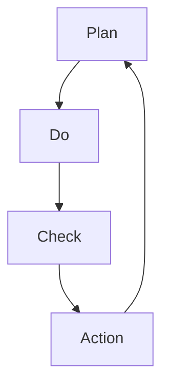
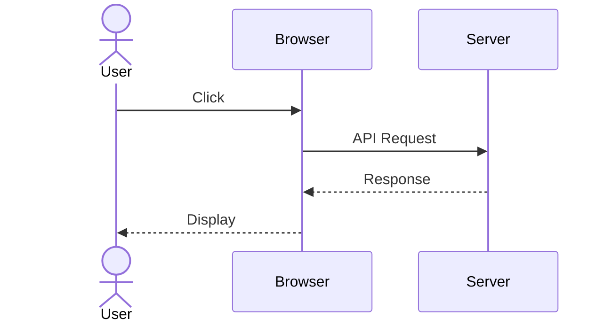

# Title

sentence

<div class="abs-br m-6 text-sm opacity-60">Presenter | Affiliation</div>

---

# Basic Slide Composition 1

> <p class="text-xl">1 message per slide</p>

<div class="h-4/5 flex flex-col flex-justify-around">
<div>Top</div>
<div>To</div>
<div>Bottom</div>
<div>Content Area</div>
</div>

<!--
A note for presenter, which is invisible on the slide
-->

---

# Basic Slide Composition 2

> <p class="text-xl">1 message per slide</p>

<div class="h-4/5 flex flex-row flex-justify-around items-center">
<div>Left</div>
<div>To</div>
<div>Right</div>
<div>Content Area</div>
</div>

---

# Code

> <p class="text-xl">Statement</p>

<div class="h-4/5 flex flex-row flex-justify-around items-center">

<div class="w-1/2">

```python {monaco}
import numpy as np

def AND(
    x1: int,
    x2: int,
) -> int:
    x = np.array([x1, x2])
    w = np.array([0.5, 0.5])
    b = -0.8
    tmp = np.sum(w*x) + b

    if tmp > 0:
        return 1
    else:
        return 0
```

</div>

<div>blah-blah-blah...</div>

</div>

---

# Mermaid

> <p class="text-xl">Statement</p>

<div class="h-4/5 flex flex-row flex-justify-around items-center">

<div class="w-1/5">



</div>

<div class="w-4/5">



</div>

</div>

---
layout: cover
background: '/assets/background.jpg'
---

# Thank you, questions?
