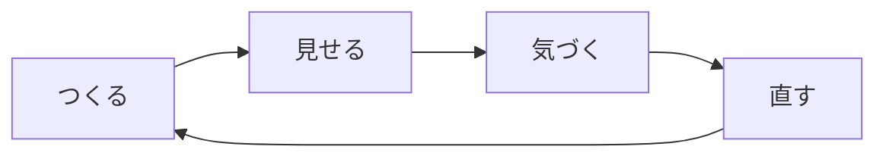

# 小さくつくって、
# 早く学ぶ。

アイデアを、動く形にするための3つの習慣

SLIDEV SAMPLE · 2026

---

# まず、仮説をひとつ

> 完璧な計画より、確かめられる問い。

  

    
①

    <b>誰のため？</b>
    
困りごとを具体的にする

  

  

    
②

    <b>何を変える？</b>
    
届けたい価値を絞る

  

  

    
③

    <b>どう確かめる？</b>
    
最小の実験を決める

  

---

# 学びのループを回す

小さな一周を、何度も。スピードは学びの回数から生まれる。

---

# まず動くものを見せよう

### 伝える → 試す → 直す

次の一歩は、今日できるサイズに。

THANK YOU · QUESTIONS?

